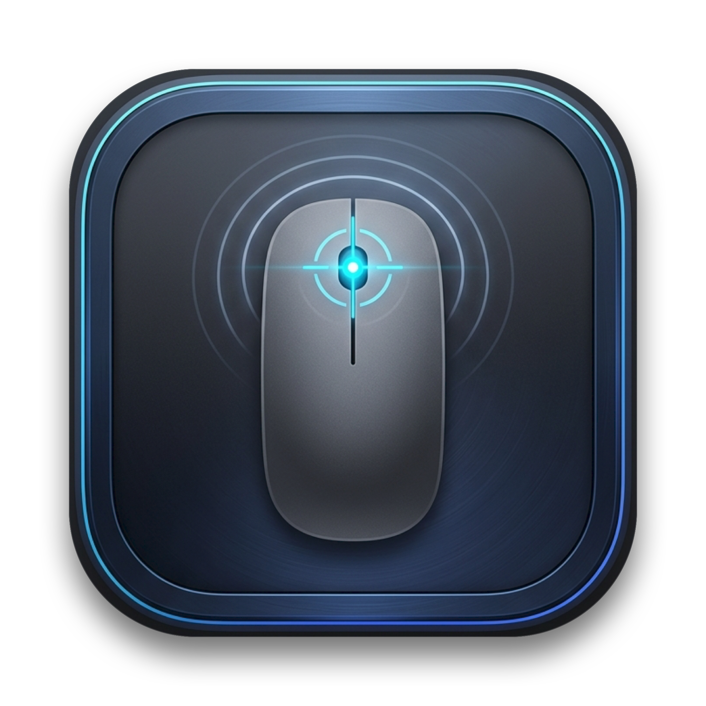

# ⚡️ Loopin

> **macOS Apple Silicon (M1 / M2 / M3 / M4 / M5) için tasarlanmış; basit, sade, ultra hafif ve Apple yerel (native) fare makro & oto-tıklayıcı uygulaması.**



---

## 🎯 Loopin Nedir?

**Loopin**, karmaşık, hantal veya üçüncü parti Electron tabanlı araçlar yerine tamamen macOS'in modern **Swift & SwiftUI** teknolojileriyle yazılmış bir fare otomasyon aracıdır.

Apple'ın tasarım diliyle (macOS Sonoma / Sequoia) kusursuz uyum sağlar, sistem menü çubuğunda (Menu Bar) veya bağımsız pencerede sessizce çalışır ve Apple Silicon mimarisinin enerji verimliliği sayesinde **neredeyse %0 CPU & pil** tüketir.

---

## ✨ Temel Özellikler

### 1. ⚡️ Akıllı Oto-Tıklayıcı (Auto Clicker)
- **Ultra Yüksek Hız:** 1 CPS'den 100+ CPS'ye (2 milisaniyeye kadar) hassas tıklama frekansı.
- **Hızlı Önayarlar:** 100 CPS (10ms), 20 CPS (50ms), 10 CPS (100ms), 1 CPS (1000ms).
- **Fare Tuşu Seçimi:** Sol Tık, Sağ Tık veya Orta Tık (Scroll wheel click).
- **Tıklama Şekli:** Tek Tık, Çift Tık, Üçlü Tık veya Basılı Tutma (Hold).
- **Hedef Konum:** İmlecin serbest bulunduğu yer veya sabit ekran koordinatı (X, Y).
- **İnsansı Rastgelelik (Organic Jitter / Anti-Detection):** Tıklama aralıklarına mikrosaniyelik dalgalanma (±ms) ve piksel sapması (±px) ekleyerek oyunlarda ve formlarda robotik tespiti engeller.

### 2. ⏺️ Makro Kaydedici & Oynatıcı (Macro Recorder & Player)
- **Canlı Eylem Kaydı:** Sol, sağ, çift tık, orta tık ve kaydırma (scroll) hareketlerini zaman farklarıyla birlikte kaydeder.
- **Görsel Zaman Çizelgesi (Timeline):** Her adımı sıra numarası, eylem ikonu, kesin ekran koordinatı ve bekleme süresiyle listeler.
- **Adım Düzenleme:** İstenmeyen adımları listeden tek tıkla silme, manuel yeni tıklama adımları ekleme.
- **Hız Çarpanı:** Makroyu 0.5x, 1x, 1.5x, 2x, 5x veya 10x hızında oynatabilme.
- **Döngü Modları:** 1 kez, N kez veya Sonsuz (∞) döngüde çalıştırma ve turlar arası bekleme süresi.
- **Makro Kütüphanesi:** Makrolara isim verip yerel olarak kaydetme ve tek tıkla geri yükleme.

### 3. 🎯 Canlı Koordinat & Hedef Bulucu (Inspector)
- **Mikrosaniye Hassasiyeti:** İmlecin ekran üzerindeki X ve Y piksel koordinatlarını canlı gösterir.
- **Hızlı Kopyalama (⌥X):** Koordinatı tek tuşla panoya kopyalar.
- **Oto Tıklayıcıya Aktar:** Anlık fare koordinatını tek tıkla oto-tıklayıcının sabit hedefi yapar.
- **Test Tıklaması:** 1 saniye geri sayımdan sonra belirtilen noktaya tek bir test tıklaması gerçekleştirir.

### 4. 🛡️ Güvenlik & Fail-Safe Koruma Mekanizmaları
- **Ekran Köşesi Kilidi (Corner Abort):** Makro veya oto-tıklayıcı çalışırken fareyi ekranın herhangi bir köşesine (0,0 vb.) çekmeniz durumunda otomasyon **anında iptal edilir**. Kontrolü asla kaybetmezsiniz!
- **ESC Tuşu Koruması:** Klavyedeki `ESC` tuşuna basıldığı anda tüm çalışan işlemler durdurulur.
- **macOS Doğal Ses Bildirimleri:** Kayıt başladığında, bittiğinde ve acil durdurmada hafif sistem sesleri (`Tink`, `Pop`, `Purr`, `Basso`) çalar.

### 5. 🍏 Apple Ekosistemi & Menü Çubuğu (Menu Bar) Entegrasyonu
- macOS Menü Çubuğu (Status Bar) ikonu üzerinden arka planda tek tıkla başlatma / durdurma.
- Yarı saydam native SwiftUI arayüzü ve SF Symbols ikonları.
- Dark Mode ve Light Mode ile %100 uyumlu.

---

## ⌨️ Küresel Kısayollar (Global Hotkeys)

| Kısayol | İşlev |
| :--- | :--- |
| `⌥ C` | Oto Tıklayıcıyı Başlat / Durdur |
| `⌥ R` | Makro Kaydını Başlat / Bitir |
| `⌥ P` | Seçili Makroyu Oynat / Durdur |
| `⌥ X` | Anlık İmleç Koordinatını Panoya Kopyala |
| `ESC` | **Acil Durdurma (Emergency Kill Switch)** |

---

## 🛠️ Derleme ve Çalıştırma

Projeyi kaynak koddan derlemek için macOS ve Command Line Tools yüklü olması yeterlidir:

```bash
# Proje dizinine girin
cd Loopin

# Derleme betiğini çalıştırın
./build.sh

# Uygulamayı başlatın
open "build/Loopin.app"
```

---

## 🔐 Sistem İzinleri (TCC)

Loopin'in sistem genelinde tıklamaları simüle edebilmesi ve kısayolları dinleyebilmesi için macOS **Erişilebilirlik (Accessibility)** izni gereklidir:
1. `Sistem Ayarları > Gizlilik ve Güvenlik > Erişilebilirlik` bölümüne gidin.
2. `Loopin` uygulamasına izin verin.

---

## 📄 Lisans

MIT License © 2026 BlackOwl
